<p align="center">
  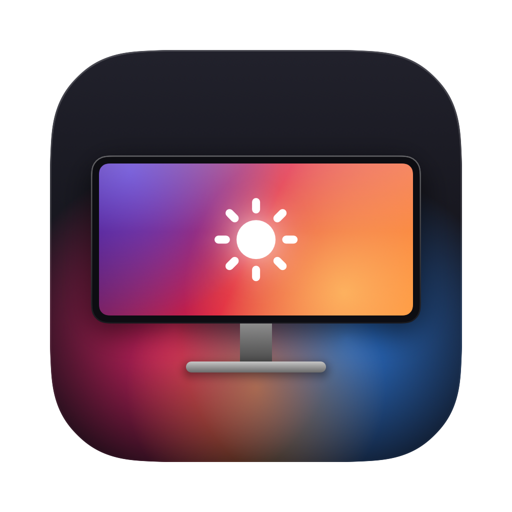
</p>

<h1 align="center">MSI Display Control</h1>

<p align="center">
  Change the on-screen menu settings of MSI gaming monitors from your Mac.<br>
  A native macOS replacement for MSI Gaming Intelligence / Gaming OSD, which only runs on Windows.
</p>

<p align="center">
  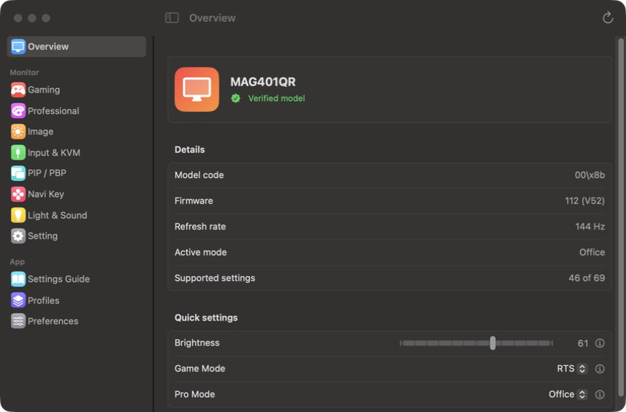
  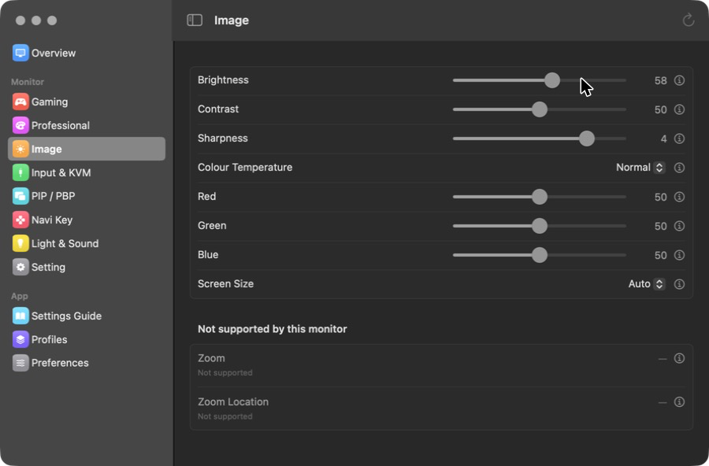
</p>

## Features

- **Every OSD setting in one window**: Game Mode, Pro Mode, Night Vision, MPRT, HDCR, Adaptive-Sync, brightness,
  colour, input, KVM, PIP/PBP, Navi Key shortcuts, RGB light and more.
- **Knows your model.** Settings your monitor does not have are shown as *Not supported* instead of failing.
- **Explains every setting** with a before/after picture, so terms like MPRT or HDCR make sense.
- **Several monitors at once**: pick the monitor at the top of the sidebar; the menu bar has a slider for each.
- **Image presets** (Standard, Mac Text, Movie, Photo Editing, Night and more) and a **resolution picker**
  that shows which macOS resolutions keep text sharp.
- **Brightness keys**: the Mac's brightness keys control the MSI monitor under the mouse pointer, with an
  on-screen indicator. Or let the monitor follow the MacBook's own brightness.
- **Profiles**: save your settings, apply them from the menu bar or with <kbd>⌃⌥1</kbd>…<kbd>⌃⌥9</kbd>.
- **Automation**: switch profiles per app, by time of day, with light/dark appearance, or per input source.
- **Shortcuts and scripts**: `msidisplay://` links and a command line tool.
- **Macro Key**: pressing the Macro Key on the monitor opens the app.
- **Firmware check**: shows the latest firmware MSI publishes for your model, with its release notes and a guided download.
- **Updates itself** from GitHub Releases. English and Persian (فارسی), with a full Help window.
- Native SwiftUI, no drivers, no kernel extensions, no background services. Universal (Apple silicon and Intel).

## What the settings do

Monitor menus are full of abbreviations. Here is what the main ones change. The same pictures are in the app under
**Settings Guide** and behind every <kbd>ⓘ</kbd> button.

| Setting | What it does | Off → On |
|---|---|---|
| **Night Vision** / **Black Tuner** | Brightens only the dark parts of the picture, so things hiding in shadows become visible. | 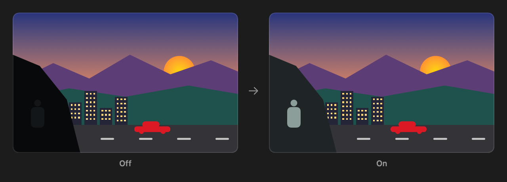 |
| **Response Time** | Overdrive. Pixels switch colour faster, which removes the smear (ghosting) behind moving objects. *Fastest* can add a light halo. | 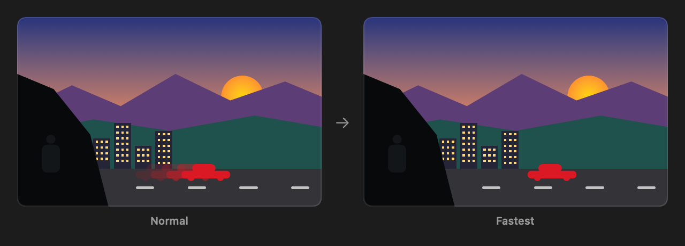 |
| **MPRT** | Moving Picture Response Time. The backlight flashes between frames so fast motion looks as sharp as a still image. The picture gets darker, and it needs more than 85 Hz. | 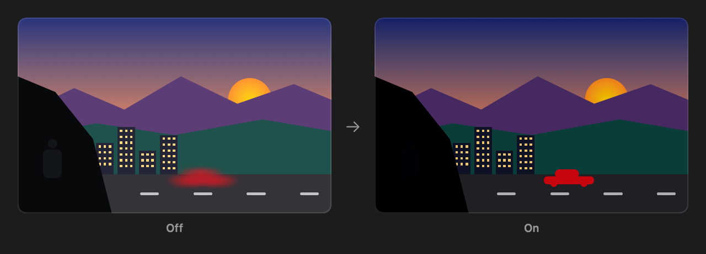 |
| **Adaptive-Sync** | FreeSync / G-Sync Compatible. The monitor waits for each frame from the graphics card, which removes tearing when the frame rate changes. | 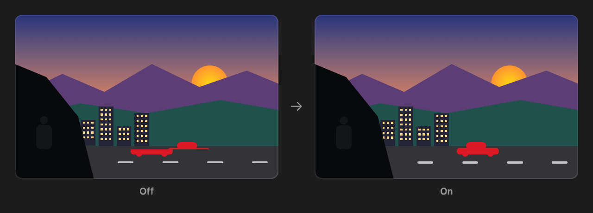 |
| **HDCR** | High Dynamic Contrast Ratio. Contrast is adjusted scene by scene. Brightness is locked while it is on. It is not real HDR. | 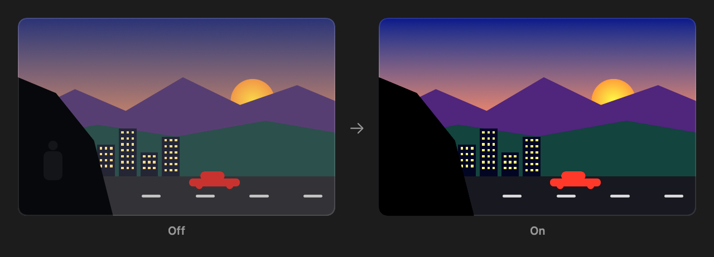 |
| **Low Blue Light** | Eye Saver. Shifts colours towards yellow to reduce blue light, which is easier on the eyes at night. | 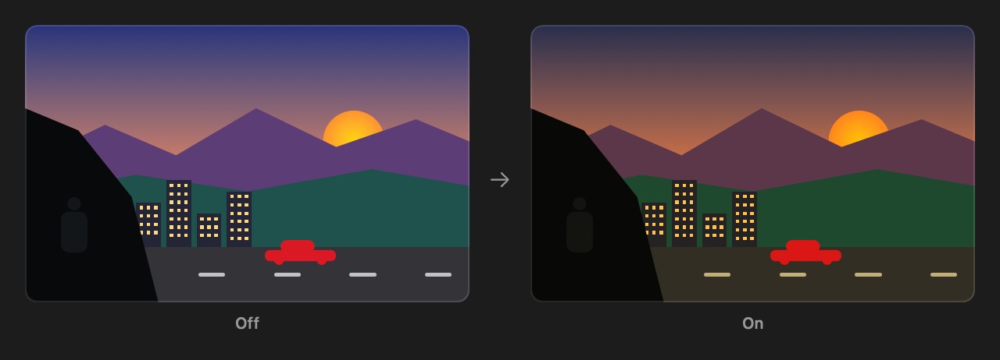 |
| **Colour Temperature** | Tint of white: *Cool* is bluish, *Warm* is yellowish. *Custom* unlocks red, green and blue. | 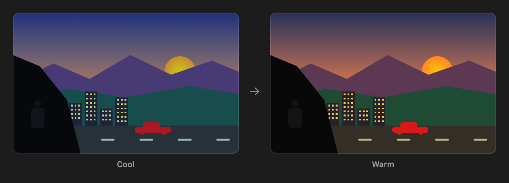 |
| **Sharpness** / **Image Enhancement** | Sharpens edges and fine detail. High values make text look rough. | 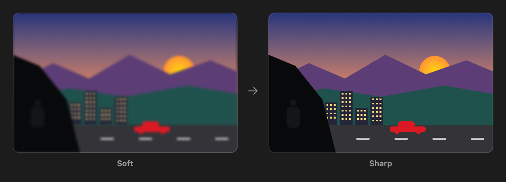 |
| **Smart Crosshair** | Draws an aiming mark in the centre of the screen. |  |
| **Refresh Rate Display** / **Alarm Clock** | Shows the refresh rate or a countdown timer in a corner. | 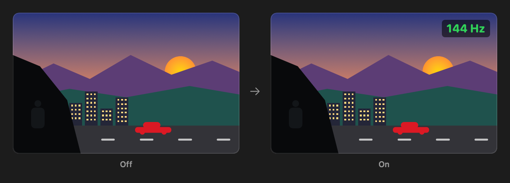 |
| **Screen Size** | How a picture with a different shape is fitted: stretched, or in its own aspect ratio with black bars. | 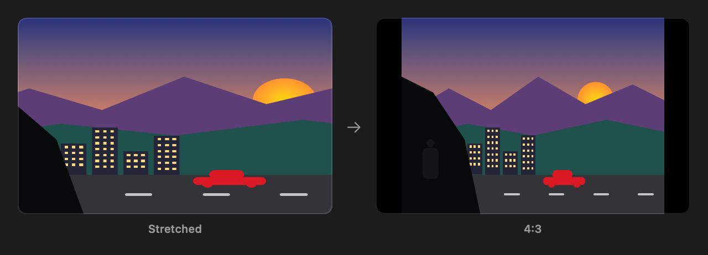 |
| **PIP / PBP** | Shows two inputs at once: a small window over the picture (PIP) or side by side (PBP). | 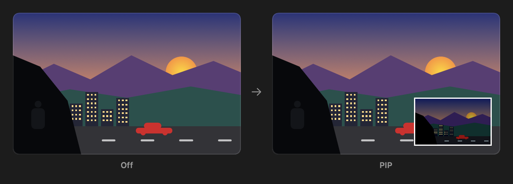 |

Other terms:

- **Game Mode / Pro Mode**: picture presets. Game modes are tuned for genres (FPS, Racing, RTS, RPG); Pro modes for work
  and video (sRGB, Movie, Office, Eco). Choosing one replaces the other.
- **KVM**: shares the keyboard and mouse plugged into the monitor between two computers.
- **Navi Key**: the small joystick on the back of the monitor. Each direction can open a shortcut.
- **HDMI CEC**: lets consoles and TV boxes wake the monitor and switch to their input.

## Supported monitors

The app talks to the *MSI Gaming Controller* USB interface that MSI gaming monitors have built in.
Settings for these models are verified, so the app can change them:

| Series | Models |
|---|---|
| MAG | MAG241C, MAG241CR, MAG251RX, MAG271CR, MAG271CQR, MAG272, MAG272CQR, MAG272QP, MAG272QR, MAG274R, MAG274QRF-QD, MAG274QRX, MAG321CURV, MAG321CQR, MAG321QR, MAG401QR |
| MPG | MPG27CQ, MPG273CQR, MPG341CQR |
| Prestige / Modern | PS341WU, MD272QP |

**Other MSI monitors** are detected too. The app reads every setting the monitor answers, but keeps them read-only
until you turn on *Preferences → Allow changes on unverified monitors*. If yours works, please open an issue with the
output of `MSIDisplayControl info` and `MSIDisplayControl list` so it can be added.

## Install

The quickest way is the install script. It downloads the latest release into *Applications*:

```sh
curl -fsSL https://raw.githubusercontent.com/drstreet/msi-display-control/main/Scripts/install.sh | sh
```

Or download `MSI-Display-Control-x.y.z.zip` from the [Releases](../../releases) page, unzip it and move
**MSI Display Control** to *Applications*.

Then connect the monitor to the Mac with a USB cable: the USB-C port (which can also carry the picture) or the
USB-B upstream port. HDMI or DisplayPort alone cannot carry settings.

Requires macOS 13 Ventura or later.

### "MSI Display Control cannot be opened"

The app is free and not notarised by Apple, which needs a paid developer account. A copy downloaded with a
browser is therefore blocked the first time. Either open *System Settings → Privacy & Security* and press
**Open Anyway**, or run:

```sh
xattr -dr com.apple.quarantine "/Applications/MSI Display Control.app"
```

The install script and the app's own updater download with `curl`/`URLSession`, which macOS does not mark,
so they are not blocked.

### Build from source

```sh
git clone https://github.com/drstreet/msi-display-control.git
cd msi-display-control
swift test                 # protocol and model table tests
./Scripts/build-app.sh     # creates dist/MSI Display Control.app and a zip
```

`swift Scripts/make-icon.swift` regenerates the app icon, and
`swift run MSIDisplayControl render-guide docs/images` regenerates the pictures above.

## Command line

The app binary doubles as a command line tool:

```sh
alias msidc="/Applications/MSI\ Display\ Control.app/Contents/MacOS/MSIDisplayControl"
msidc monitors          # connected MSI monitors
msidc info              # model and firmware
msidc list              # every setting with its current value
msidc get 00400         # brightness
msidc set 00400 70      # set brightness to 70
msidc --monitor 2 list  # the second monitor
msidc firmware          # latest firmware on msi.com for the connected model
```

Codes are listed by `list`. Values are option numbers, starting at 0.

### Links for Shortcuts

In the Shortcuts app, use the *Open URLs* action with links like these. Add `?monitor=2` for the second monitor.

```text
msidisplay://brightness/70
msidisplay://brightness/+10
msidisplay://preset/Night
msidisplay://profile/Gaming
msidisplay://input/1
msidisplay://set/00410/60
```

Protocol notes for contributors are in [docs/PROTOCOL.md](docs/PROTOCOL.md).

## The extra "Optix Driver" disk

Some MSI monitors also show up as a small USB disk (named *Optix Driver* or *NO NAME*) that comes back after every
eject. It only holds the Windows driver. To stop macOS from mounting it, find its UUID and add it to `/etc/fstab`:

```sh
diskutil info "/Volumes/NO NAME" | grep "Volume UUID"
echo 'UUID=<the UUID> none msdos rw,noauto' | sudo tee -a /etc/fstab
```

Reconnect the monitor afterwards.

## Firmware updates

The Overview page lists the firmware MSI publishes on msi.com for your model, with what each version changes.
**Update Firmware…** downloads the official package after a safety checklist. MSI installs firmware with MSI Gaming
Intelligence on Windows; macOS cannot flash the monitor, and this app never sends firmware to it.

## Safety

MSI does not document this interface, and the monitor firmware does not check the commands it receives. To keep that
risk low the app:

- only sends settings from its own table, with values the model accepts, and reads every change back;
- never sends power, factory reset, firmware update or OSD language commands;
- never scans unknown registers, some of which are known to hang the firmware;
- keeps unknown models read-only unless you allow changes.

If a change cuts off the picture or the USB link (for example Input or KVM), use the Navi Key on the monitor to switch
back. Use the app at your own risk.

## Credits

The protocol and most model tables come from [msigd](https://github.com/couriersud/msigd) by couriersud, with protocol
notes from [msi-mpg-271qr-control](https://github.com/storkme/msi-mpg-271qr-control).

This project is not affiliated with or endorsed by Micro-Star International (MSI). MSI, Mystic Light, Optix and
Gaming Intelligence are trademarks of their respective owners.

## License

[GNU General Public License v3.0](LICENSE)
